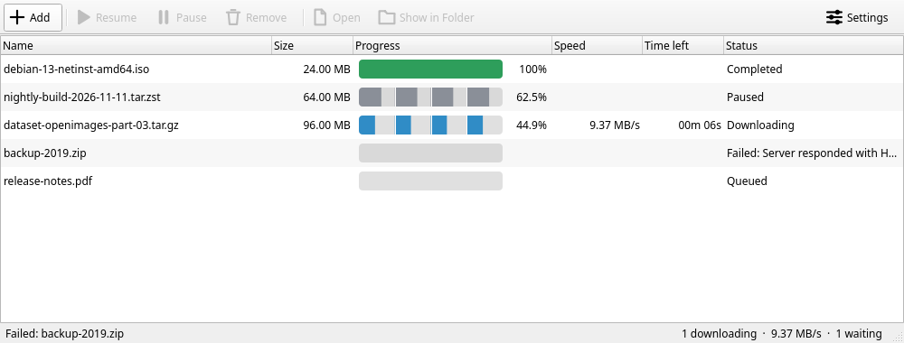
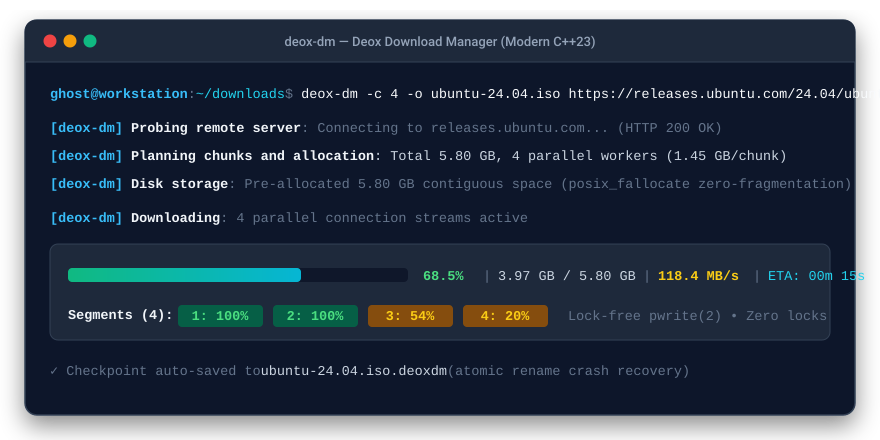

# Deox Download Manager (`deox-downloadmanager`)

[](https://github.com/DancinGhost/deox-downloadmanager/actions/workflows/canary.yml)
[](LICENSE)
[](https://en.wikipedia.org/wiki/C%2B%2B23)
[](docs/PLATFORMS.md)

> **Deox Download Manager** is a blazingly fast, memory-safe, multi-connection segmented download manager written in modern C++23 using the **Functional Core, Imperative Shell (FCIS)** architecture. Designed with a clean cross-platform abstraction layer, MIT licensing, and no statically linked copyleft dependencies.

---

## 📸 Interface Previews

### Desktop Application (`deox-dm-gui` with Qt 6)
<p align="center">
  
</p>

### Terminal CLI (`deox-dm`)
<p align="center">
  
</p>

---

## 🎯 Motivation: Modern C++23 vs. Rust

In recent years, the systems programming community has witnessed a surge of CLI and networking tools written in Rust, driven by the narrative that C++ cannot provide memory safety without sacrificing developer ergonomics.

**Deox Download Manager proves that modern C++23 can be just as safe, explicit, and fast as Rust.**

| Feature | Rust Download Managers | Deox Download Manager (Modern C++23) |
| :--- | :--- | :--- |
| **Safety Invariants** | Ownership borrow checker | Value semantics, RAII, bounds-checked `std::span`, zero raw owning pointers |
| **Error Handling** | `Result<T, E>` monadic types | `std::expected<T, E>` monadic error handling across all boundaries |
| **Concurrency Model** | `tokio` async runtime (heavy state machine) | Native OS `std::jthread` pool, cooperative cancellation (`std::stop_token`) |
| **File I/O Throughput** | Multi-threaded file writes | Lock-free concurrent positional writes (`pwrite(2)` / Win32 `OVERLAPPED`) |
| **Disk Allocation** | Varies by implementation | Zero-fragmentation preallocation (`posix_fallocate(2)` / sparse fallback) |
| **Hidden Mechanisms** | Hidden async poll loops, large runtime crates | **Zero hidden mechanisms**: completely explicit, deterministic, transparent |
| **Licensing** | Varies by project | **MIT License**; copyleft libraries (Qt 6, LGPL) only via dynamic linking |

---

## 🏛️ Architecture: Functional Core, Imperative Shell

Deox strictly separates pure business logic from side-effectful I/O into a modular, multi-tier library structure:

```
                    ┌───────────────────────────────────────────────┐
                    │               IMPERATIVE SHELL                │
                    │   • deoxdm_net: HTTP Range requests (libcurl) │
                    │   • deoxdm_engine: Orchestration & Concurrency│
                    │   • deoxdm_platform: OS file & terminal layer │
                    └───────┬───────────────────────────────▲───────┘
                            │ Calls pure functions          │ Returns immutable
                            │ with input state              │ values / results
                    ┌───────▼───────────────────────────────┴───────┐
                    │                FUNCTIONAL CORE                │
                    │                 (deoxdm_core)                 │
                    │  • URL Validation & Path Traversal Defense    │
                    │  • Mathematical Chunk Division                │
                    │  • Exponential Moving Average (EMA) Speed     │
                    │  • Deterministic State Machine Transitions    │
                    │  • FIPS 180-4 Streaming SHA-256 Hashing       │
                    │  • Checkpoint Serialization / Deserialization │
                    └───────────────────────────────────────────────┘
```

1. **`deoxdm_core` (Functional Core)**: Pure domain logic without any filesystem or network I/O. Referentially transparent functions returning monadic `std::expected<T, Error>`.
2. **`deoxdm_platform` (Platform Abstraction)**: The only code that talks to the operating system: positional file I/O (`platform::File`), atomic file commits, UTF-8 path conversion, terminal capabilities and Ctrl-C handling. Linux is supported; a Windows backend is drafted. See [docs/PLATFORMS.md](docs/PLATFORMS.md).
3. **`deoxdm_net` (Network Layer)**: Robust HTTP client built on libcurl with capability probing, range verification, stall timeouts, and retry policies.
4. **`deoxdm_engine` (Engine & Concurrency)**: Multi-worker thread orchestration, token-bucket bandwidth rate limiter, and atomic checkpoint persistence (`.deoxdm`).
5. **Applications (`apps/`)**:
   - `apps/cli/`: The `deox-dm` terminal client with interactive ANSI dashboard and plain milestone logging for scripts and CI.
   - `apps/gui/`: The `deox-dm-gui` desktop client powered by Qt 6 Widgets with queue management and desktop integration (`model/` for state, `views/` for widgets).

For a deeper dive into the architecture, see [docs/ARCHITECTURE.md](docs/ARCHITECTURE.md).

---

## ⚖️ Licensing & Dependencies

- **MIT License**: Deox Download Manager's own code is licensed under the permissive [MIT License](LICENSE), with `SPDX-License-Identifier: MIT` headers in its source and build files.
- **No vendored third-party code**: the repository contains only original code. Run-time libraries and their licenses are listed in [THIRD_PARTY_NOTICES.md](THIRD_PARTY_NOTICES.md).
- **Copyleft only through dynamic linking**: libcurl (curl license, MIT-style) is used by every program. The optional desktop application uses Qt 6 under the LGPL-3.0, linked dynamically so that users can replace it. The build refuses a static Qt 6 unless `-DDEOXDM_ALLOW_STATIC_COPYLEFT=ON` is set.
- **Redistributing binaries**: if you bundle libcurl, Qt, or a TLS library with a build, ship their notices along with it as described in [THIRD_PARTY_NOTICES.md](THIRD_PARTY_NOTICES.md).

---

## 🚀 Key Features

- ⚡ **Multi-Connection Segmented Acceleration**: Spawns multiple parallel workers utilizing HTTP/HTTPS `Range` requests for maximum bandwidth saturation.
- 💾 **Resumable Downloads**: Automatic crash-recovery checkpointing (`<file>.deoxdm`). Resume interrupted transfers at the exact byte boundary without re-downloading finished segments.
- 🔒 **End-to-End Checksum Verification**: Integrated streaming SHA-256 (FIPS 180-4) hash verification directly from disk without reading the entire file into RAM.
- 🛡️ **Path Traversal Defense**: Strict URL and filename sanitization protecting against `../` path injection attacks and reserved filesystem names.
- 📊 **Smoothed Throughput Tracking**: Exponential Moving Average (EMA) algorithm for stable transfer speed tracking and accurate ETA predictions.
- ⏱️ **Shared Rate Limiting**: Global bandwidth throttling across all concurrent connection streams.
- 🖥️ **Dual Interfaces**: Choose between the powerful CLI (`deox-dm`) or the modern Qt 6 Desktop application (`deox-dm-gui`).
- 🧪 **100% ASan & UBSan Clean**: Verified against AddressSanitizer and UndefinedBehaviorSanitizer with zero memory leaks and zero undefined behavior.

---

## 📦 Canary Builds

Every push to `main` that passes the test suite is published as the rolling [`canary` prerelease](https://github.com/DancinGhost/deox-downloadmanager/releases/tag/canary). The archive contains `deox-dm`, `deox-dm-gui`, the desktop entry, the icon and the license texts.

```bash
curl -LO https://github.com/DancinGhost/deox-downloadmanager/releases/download/canary/deox-dm-canary-linux-x86_64.tar.gz
curl -LO https://github.com/DancinGhost/deox-downloadmanager/releases/download/canary/SHA256SUMS
sha256sum -c SHA256SUMS
tar -xzf deox-dm-canary-linux-x86_64.tar.gz
./deox-dm-canary-linux-x86_64/bin/deox-dm --version
```

There are no numbered releases yet: `deox-dm --version` reports the build as `canary-<commit>`. Canary builds are untested beyond CI. They are built on Ubuntu 24.04 (glibc 2.39) and need the system's `libcurl4` and, for the GUI, Qt 6 (`libqt6widgets6`).

---

## 🛠️ Building & Testing

### Prerequisites
- C++23 compliant compiler: `g++` (>= 14) or `clang++` (>= 18)
- `cmake` (>= 3.20)
- `libcurl` runtime (`libcurl.so.4` or `libcurl4-openssl-dev`)
- *(Optional for GUI)*: `qt6-base-dev` (Qt 6.4+)

### Build Instructions

```bash
# Clone repository
git clone https://github.com/DancinGhost/deox-downloadmanager.git
cd deox-downloadmanager

# Configure with CMake (auto-detects Qt 6 for GUI)
cmake -B build -DCMAKE_BUILD_TYPE=Release

# Build CLI, GUI, and tests
cmake --build build -j$(nproc)

# Run full test suite
ctest --test-dir build --output-on-failure
```

### Building with Sanitizers (ASan + UBSan)

```bash
cmake -B build-asan -DCMAKE_BUILD_TYPE=Debug -DDEOXDM_ENABLE_ASAN=ON
cmake --build build-asan -j$(nproc)
ctest --test-dir build-asan --output-on-failure
```

### Hardening

Builds include exploit mitigations by default: `-fstack-protector-strong`, stack clash and control-flow protection where the compiler supports them, `_FORTIFY_SOURCE=3` in optimized builds without sanitizers, position-independent executables and, on Linux, full RELRO. Pass `-DDEOXDM_ENABLE_HARDENING=OFF` to leave them out.

---

## 📖 CLI Usage (`deox-dm`)

```
Usage: deox-dm [OPTIONS] <URL>...

Segmented, resumable HTTP(S) download manager.

Downloads each URL over several parallel connections when the server supports
range requests. An interrupted download leaves a "<file>.deoxdm" checkpoint next
to the partial file; running the same command again continues it.

Arguments:
  <URL>...                   One or more http:// or https:// URLs

Output:
  -o, --output <FILE>        Write to FILE, replacing it if it exists (single URL only)
  -d, --dir <DIR>            Save into DIR (created if missing) instead of the current directory
      --overwrite            Replace an existing file instead of saving as "name.1.ext"
  -i, --input-file <FILE>    Read URLs from FILE, one per line ("-" for standard input)

Transfer:
  -c, --connections <NUM>    Parallel connections per download, 1-64 (default: 4)
  -l, --limit-rate <RATE>    Cap the download speed, e.g. 500K or 2M bytes per second
  -t, --timeout <SEC>        Give up on a connection attempt or a stalled transfer
                             after SEC seconds; 0 disables the timeout (default: 30)
  -r, --retries <NUM>        Retries per segment after a transient failure (default: 3)
      --no-resume            Ignore an existing checkpoint and start over
  -H, --header <LINE>        Add a request header, e.g. -H "Authorization: Bearer ..." (repeatable).
                             Headers are only sent to the host of the URL, not to
                             other hosts it redirects to
  -H @<FILE>                 Read headers from FILE, one per line ("-" for standard
                             input); keeps secrets out of the process list
  -A, --user-agent <NAME>    Send NAME as the User-Agent
  -k, --insecure             Do not verify TLS certificates

Verification:
  -s, --sha256 <HEX>         Verify the finished file against this SHA-256 checksum

Other:
  -q, --quiet                Print nothing but errors
  -V, --version              Show version information
  -h, --help                 Show this help

Proxies are taken from the http_proxy, https_proxy and no_proxy environment variables.
Redirects from an https URL to a plain http address are refused.
```

### CLI Examples

```bash
# Basic download with 4 parallel connections
deox-dm https://releases.ubuntu.com/24.04/ubuntu-24.04-desktop-amd64.iso

# High-concurrency download with custom output and SHA-256 validation
deox-dm -c 16 -o linux.iso -s a1b2c3d4... https://example.com/linux.iso

# Bandwidth-limited background download (cap at 2 MB/s)
deox-dm -l 2M -d ~/Downloads https://example.com/huge-archive.tar.gz

# Batch download from file or stdin
deox-dm -i urls.txt
cat urls.txt | deox-dm -i -
```

---

## 🖥️ Desktop Application (`deox-dm-gui`)

Launch the graphical interface:
```bash
./build/deox-dm-gui
```
Or pass initial URLs directly from the terminal or web browser:
```bash
deox-dm-gui https://example.com/file1.zip https://example.com/file2.tar.gz
```

On Linux desktops, desktop integration files are installed to system directories:
- Application launcher: `packaging/linux/io.github.DancinGhost.DeoxDownloadManager.desktop`
- Scalable vector icon: `packaging/linux/io.github.DancinGhost.DeoxDownloadManager.svg`

---

## 📜 License

This project is licensed under the **MIT License** - see the [LICENSE](LICENSE) file for details.

Copyright (c) 2026 DancinGhost and Deox Contributors.

Third-party library notices are in [THIRD_PARTY_NOTICES.md](THIRD_PARTY_NOTICES.md).

Qt is a registered trademark of The Qt Company Ltd. Linux is the registered trademark of Linus Torvalds. Windows is a trademark of the Microsoft group of companies. Rust is a trademark of the Rust Foundation. Ubuntu is a registered trademark of Canonical Ltd. Other names are trademarks of their respective owners and are used here for identification only; no endorsement is implied.
